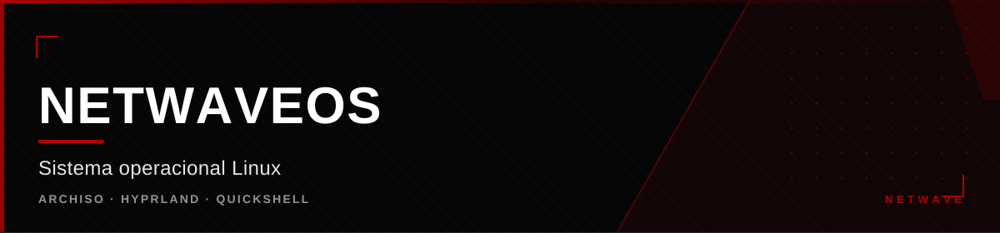

<div align="center">



</div>

<div align="center">

[](https://github.com/hiro0010/netwaveos) [](https://github.com/hiro0010/netwaveos) [](https://github.com/hiro0010/netwaveos) [](https://github.com/hiro0010/netwaveos)

</div>


## O que é

NetwaveOS é uma distribuição Linux construída sobre a base CachyOS, com
identidade visual, componentes e camada de sistema próprios. O objetivo não é
substituir o Arch — é aproveitar a estabilidade dele e acrescentar uma
camada Netwave: shell, ferramentas, temas e a Yuna embutida.

---

## Como é construído

Usa **archiso**, o framework oficial de imagem do Arch. O processo:

```
./buildiso.sh -p desktop
  → pacstrap da base CachyOS
  → cópia da camada Netwave (scripts, QML, temas, serviços)
  → branding (os-release, GRUB, Syslinux, hostname)
  → xorriso grava a ISO híbrida
  → SHA-1 e SHA-256 dos artefatos
```

### A armadilha do build

O mkarchiso copia o `airootfs` **antes** de instalar pacotes. Se o airootfs
contiver um arquivo que pertence a um pacote — `cachyos-branding`,
`hyprland.desktop`, `lsb-release`, `cachyos-mirrorlist` — o pacstrap falha com
conflito de propriedade.

**Solução:** manter no airootfs apenas arquivos que não pertencem a pacotes, e
aplicar branding e cópias finais em `customize_airootfs.sh`, depois das
transações.

---

## A camada Netwave

| Componente | Papel |
|---|---|
| **Hyprland** | Shell Wayland — 8 workspaces, hypridle, hyprpaper |
| **Quickshell** | Dashboard e settings em QML (Waybar como fallback) |
| **SwayNC** | Notificações |
| **Waybar** | Barra de status e barra de fallback |
| **Kitty + Wofi** | Terminal e launcher |
| **Calamares** | Instalador com módulo `shellprocess-netwave` |
| **Yuna** | CLI e ferramentas de diagnóstico, status e projetos |

Sessões disponíveis: `netwave.desktop` (Hyprland/Wayland) e
`netwave-x11.desktop` (Plasma X11, como fallback).

### Perfis de pacotes

| Perfil | Foco |
|---|---|
| `desktop` | Hyprland + Plasma X11, ambiente completo |
| `dev` | Ferramentas de desenvolvimento |
| `gaming` | Emulação, drivers e otimizações |
| `vm` | Ferramentas de virtualização |

---

## Identidade

Logo, ícone, wallpaper, tema de cores, prompt do terminal, Waybar, SwayNC e
branding do Calamares. A identidade visual é da Netwave, mas a base continua
sendo Arch — a rastreabilidade do que é upstream e o que é próprio fica
explícita.

---

## Segurança

A PolicyKit global `wheel` sem senha foi **removida** e substituída por
`netwave.policy` com regra específica de diagnóstico. A Yuna embarcada é
**read-only**: diagnostica, mostra status, consulta pacotes e lista projetos —
ações privilegiadas não são executadas pela interface.

---

## Status

ISO desktop gerada e validada estaticamente, com boot testado em BIOS e UEFI
via QEMU/OVMF até o carregamento do bootloader e do kernel. A camada de
identidade, o dashboard e a Yuna read-only estão criados. Faltam o boot
completo validado, assinatura GPG e a consolidação da source em repositório
próprio.


<div align="center">

<sub>Parte da <a href="https://github.com/hiro0010/netwave">Netwave</a>
&middot; Owner: <a href="https://github.com/hiro0010">Hiro</a></sub>

</div>
